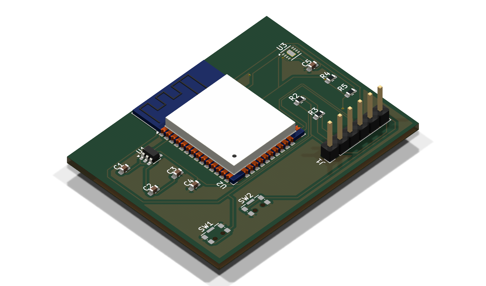
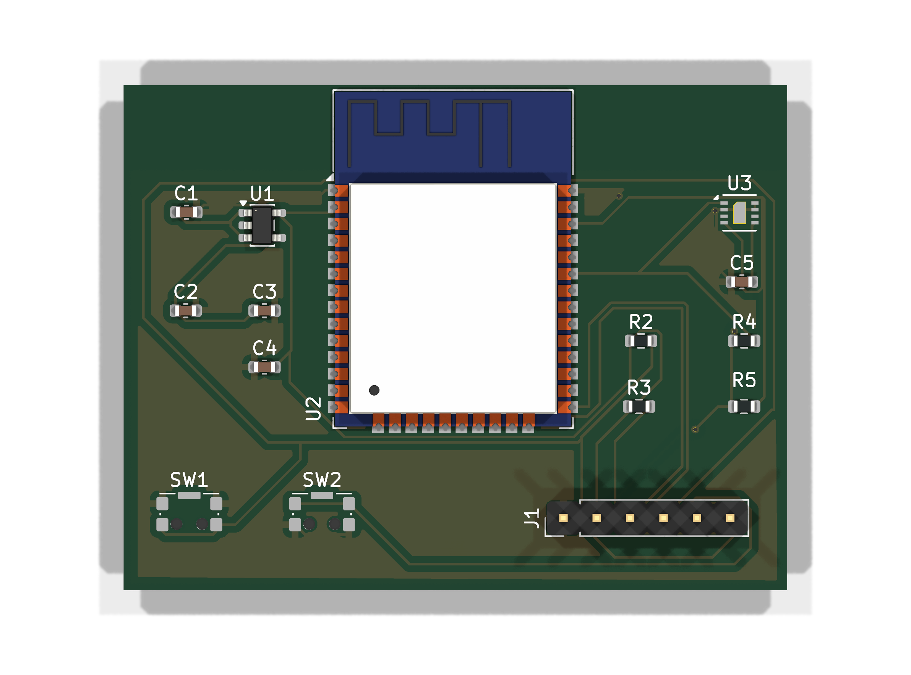
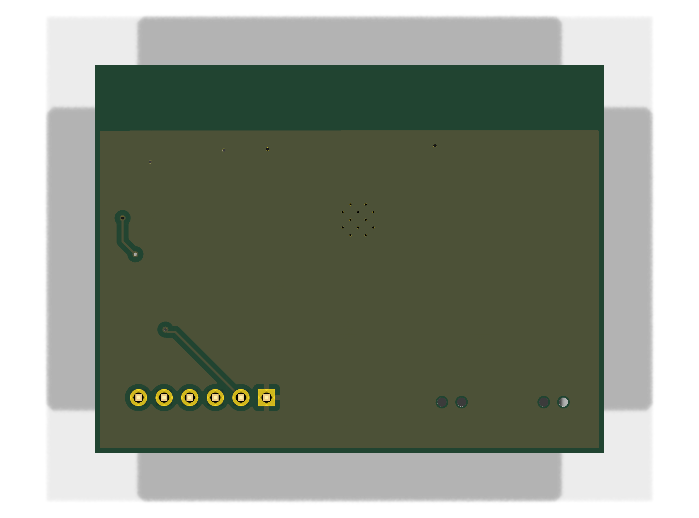
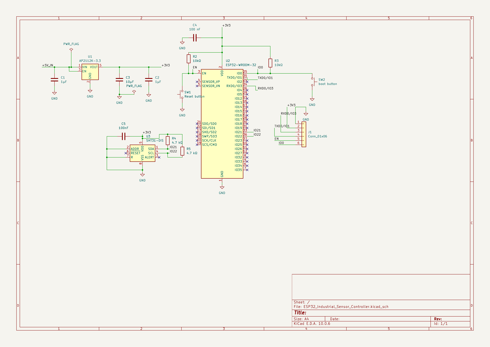

# ESP32 Industrial Sensor Controller

[](https://www.kicad.org/)
[](https://github.com/Eswar-426/ESP32-Industrial-Sensor-Controller)
[](docs/erc-report.rpt)
[](docs/drc-report.rpt)
[](https://www.espressif.com/)

A custom, compact PCB designed in **KiCad 10** for an ESP32-based industrial temperature and humidity monitoring system.

The board integrates an **ESP32-WROOM-32** Wi-Fi & Bluetooth microcontroller module, a high-precision **Sensirion SHT31-DIS** digital environmental sensor, and an ultra-low-dropout **AP2112K-3.3** voltage regulator. It features dedicated I²C bus pull-up resistors, hardware Reset and Boot mode tactile switches, comprehensive decoupling networks, and an FTDI-compatible 6-pin UART interface for flashing and serial telemetry.

---

## 3D Board Visualization

<p align="center">
  
</p>

<p align="center">
  
  &nbsp;
  
</p>

---

## Features

- **Microcontroller Core:** Espressif ESP32-WROOM-32 dual-core Tensilica Xtensa 32-bit LX6 processor with 2.4 GHz Wi-Fi (802.11 b/g/n) and Bluetooth v4.2 BR/EDR & BLE.
- **Precision Environmental Sensing:** Sensirion SHT31-DIS digital sensor connected via I²C bus (`IO21` SDA, `IO22` SCL) providing ±2% RH accuracy and ±0.2 °C temperature accuracy.
- **Power Management:** AP2112K-3.3 high-current (600 mA), low-noise, ultra-low dropout (LDO) linear regulator delivering stable 3.3 V with dedicated input and output decoupling.
- **Programming & Serial Telemetry:** 6-pin 2.54 mm pitch UART programming header with direct connections to ESP32 UART0 (`TXD0`/`RXD0`), power rails, reset line (`EN`), and boot line (`IO0`).
- **Tactile User Controls:** Dedicated tactile buttons for hardware Reset (`SW1`, EN to GND) and Boot Mode configuration (`SW2`, IO0 to GND) with external 10 kΩ pull-ups.
- **Robust Signal & Power Integrity:** 2-layer PCB stackup with continuous front (F.Cu) and back (B.Cu) ground copper pours, low-inductance thermal via stitching, and dedicated 0603 decoupling capacitors per IC.
- **Antenna Keepout Compliance:** Clean PCB cutout/keepout area maintained around the ESP32 onboard PCB trace antenna to preserve RF performance.

---

## Schematic Overview

<p align="center">
  
</p>

*Complete schematic available in vector format: [docs/schematic.pdf](docs/schematic.pdf).*

---

## Bill of Materials (BOM)

| Reference | Value / Part | Package / Footprint | Description | Qty |
| :--- | :--- | :--- | :--- | :---: |
| **U1** | `AP2112K-3.3` | SOT-23-5 | 600 mA Low-Dropout Linear Voltage Regulator (5V to 3.3V) | 1 |
| **U2** | `ESP32-WROOM-32` | SMD-38 (18×25.5 mm) | Espressif Dual-Core Wi-Fi & BLE Microcontroller Module | 1 |
| **U3** | `SHT31-DIS` | DFN-8 (2.5×2.5 mm) | Sensirion High-Precision Digital Humidity & Temperature Sensor | 1 |
| **C1, C2** | `1 µF` | 0603 SMD | Input & Output Filter Capacitors for AP2112K LDO | 2 |
| **C3** | `10 µF` | 0603 SMD | Bulk Decoupling Capacitor for ESP32 3V3 Rail | 1 |
| **C4, C5** | `100 nF` | 0603 SMD | High-Frequency Bypass / Decoupling Capacitors (ESP32 & SHT31) | 2 |
| **R2, R3** | `10 kΩ` | 0603 SMD | Pull-Up Resistors for Boot (`IO0`) and Reset (`EN`) Lines | 2 |
| **R4, R5** | `4.7 kΩ` | 0603 SMD | Dedicated Pull-Up Resistors for I²C Bus (`SDA`, `SCL`) | 2 |
| **SW1, SW2** | `SPST Push Button` | SMD (KMS2xxGP) | Reset (`EN`) and Boot (`IO0`) Control Switches | 2 |
| **J1** | `6-Pin Header (1x06)`| PinHeader 2.54 mm Vertical | UART Interface for Flashing, Debugging & Power Input | 1 |

*Machine-readable CSV format: [docs/bom.csv](docs/bom.csv).*

---

## Pinout & Interface Mapping

### Programming Header (J1)

| Pin | Net Name | Target Device / Pin | Function / Usage |
| :---: | :---: | :---: | :--- |
| **1** | `GND` | System Ground Plane | Common ground connection |
| **2** | `+3.3V` | System 3.3 V Power Rail | 3.3 V supply rail / power monitor |
| **3** | `RXD0` | ESP32 `RXD0` (`GPIO3`) | Serial receive from external USB-UART programmer (TX) |
| **4** | `TXD0` | ESP32 `TXD0` (`GPIO1`) | Serial transmit to external USB-UART programmer (RX) |
| **5** | `EN` | ESP32 `EN` (Chip Enable) | Hardware reset control (active low) |
| **6** | `IO0` | ESP32 `GPIO0` (Boot) | Flashing bootloader entry (pull low during reset) |

### Internal Sensor Bus (I²C)

| Sensor Pin | Net Name | ESP32 Pin | Function |
| :---: | :---: | :---: | :--- |
| **Pin 1 (SDA)** | `IO21` | `GPIO21` | I²C Serial Data (pulled up by R4: 4.7 kΩ to 3.3V) |
| **Pin 4 (SCL)** | `IO22` | `GPIO22` | I²C Serial Clock (pulled up by R5: 4.7 kΩ to 3.3V) |

---

## Design Tools & Verification

### Design Suite
- **KiCad Version:** 10.0.7
- **Schematic Capture:** KiCad Eeschema
- **Layout & Routing:** KiCad PCB Editor
- **Verification Engine:** KiCad Electrical Rules Checker (ERC) & Design Rules Checker (DRC)

### Verification Methodology & Results
- **Schematic ERC:** Passed with **0 errors and 0 warnings**. Power flags, pin types, and hierarchical nets verified. See [docs/erc-report.rpt](docs/erc-report.rpt).
- **PCB DRC:** Passed with **0 violations and 0 unconnected items**. Track widths, clearances, annular rings, drill sizes, and solder mask bridges conform to standard 2-layer PCB fabrication specifications. See [docs/drc-report.rpt](docs/drc-report.rpt).
- **Copper Architecture:** Solid ground polygon pours on both Top (F.Cu) and Bottom (B.Cu) layers, interconnected with stitching vias for thermal relief and return path continuity.
- **RF Best Practices:** Antenna trace area isolated from underlying copper planes and external routing traces to ensure signal integrity.

> **Verification Scope Notice:**  
> The hardware design has been fully verified using KiCad's Electrical Rules Check (ERC) and PCB Design Rules Check (DRC). Physical board fabrication, component assembly, firmware flashing, and hardware bench testing have not yet been performed. Fabrication constraints must be re-checked against specific manufacturer design capabilities (e.g., JLCPCB, PCBWay) prior to ordering production panels.

---

## Repository Structure

```
ESP32-Industrial-Sensor-Controller/
├── README.md                                      # Project overview, schematics, BOM, and pinout
├── .gitignore                                     # KiCad lock, backup, and local cache filters
├── hardware/
│   ├── ESP32_Industrial_Sensor_Controller.kicad_pro  # KiCad 10 project file
│   ├── ESP32_Industrial_Sensor_Controller.kicad_sch  # Complete schematic file
│   └── ESP32_Industrial_Sensor_Controller.kicad_pcb  # Fully routed PCB layout
└── docs/
    ├── schematic.pdf                              # Printable vector schematic
    ├── schematic.png                              # High-resolution schematic diagram
    ├── pcb-3d.png                                 # High-definition 3D raytraced board render
    ├── pcb-front.png                              # 3D top render
    ├── pcb-back.png                               # 3D bottom render
    ├── bom.csv                                    # Detailed Bill of Materials
    ├── drc-report.rpt                             # KiCad PCB DRC report (0 errors)
    └── erc-report.rpt                             # KiCad Schematic ERC report (0 errors)
```

---

## Future Improvements & Roadmap

- [ ] Order prototype batch from PCB manufacturer (e.g., JLCPCB / PCBWay) with stencil.
- [ ] Surface-mount component soldering & hot-air rework validation.
- [ ] Power supply rail validation under dynamic RF load (3.3 V line ripple and thermal dissipation).
- [ ] ESP-IDF / Arduino C++ firmware development:
  - SHT31 driver implementation with periodic temperature and relative humidity polling.
  - Non-volatile storage (NVS) Wi-Fi credential provisioning.
  - MQTT / HTTP telemetry publishing to cloud/local IoT dashboards (Home Assistant, AWS IoT, or ThingsBoard).
  - ESP32 Deep Sleep power optimization.
- [ ] Enclosure design (3D printed industrial DIN-rail or wall-mount enclosure).

---

## Project Status

**PCB Design Completed** — Prototype fabrication and hardware validation pending.

---

## Author

**Eswar**  
ECE Undergraduate | Class of 2026  
*Developed as a PCB design and embedded systems portfolio project.*
